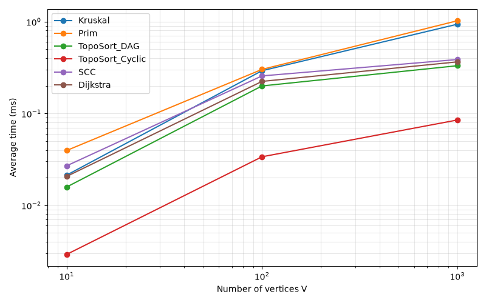
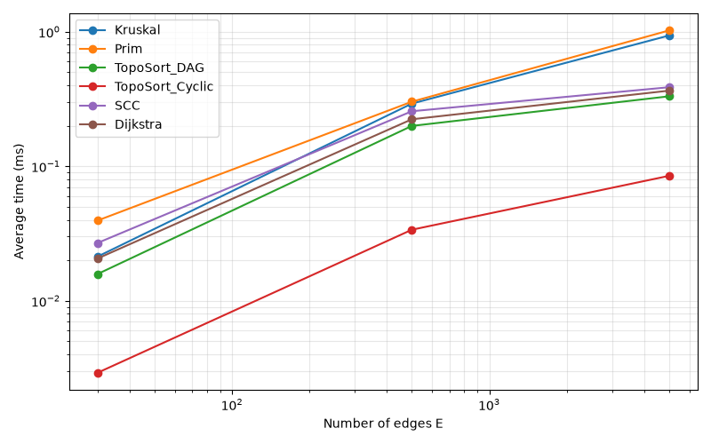
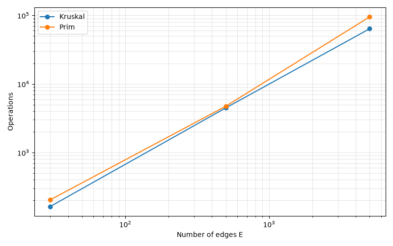

# Assignment 3 — Smart City Infrastructure and Route Planning

## Overview
A smart city is modelled as a graph. Vertices are districts (numbered 0..V-1), edges are roads or infrastructure links, and weights are integer construction costs or distances in the range 1..100.

The graph is stored as an adjacency list (`List<List<Edge>>`) plus a global list of edges, which Kruskal needs for sorting. `Graph` works in two modes:
- undirected: every edge is stored in both adjacency lists but only once in the global edge list;
- directed: every edge is stored once.

Project structure:

```
src/
├── graph/         Edge, Graph, GraphGenerator
├── dsu/           DSU
├── mst/           MSTResult, Kruskal, Prim
├── connectivity/  TopologicalSort, SCC
├── shortestpath/  Dijkstra
├── experiments/   Benchmark
├── Main.java
└── TestRunner.java
results/
├── tables/        results.csv
└── plots/         time_vs_vertices.png, time_vs_edges.png, ops_kruskal_vs_prim.png
plots.py
```

## Implementation
- **GraphGenerator**: every generator takes `(V, E, seed)` and uses `new Random(seed)`, so graphs are reproducible. Weights are `nextInt(100) + 1`, so they are always positive. Loops and duplicate edges are rejected using a `Set<Long>` of edge keys. A check on `E` prevents an endless loop when too many edges are requested.
- **DSU**: `find` uses path compression, `union` uses union by rank. Counters record the number of `find` and `union` calls.
- **Kruskal**: copies the edge list, sorts it by weight, and adds an edge when `union` succeeds. It stops after V-1 edges. If fewer than V-1 edges were accepted, the graph is reported as disconnected.
- **Prim**: starts from vertex 0 and uses a binary-heap `PriorityQueue<Edge>`. Edges leading to vertices already in the tree are skipped when polled. If fewer than V vertices were reached, the graph is disconnected.
- **TopologicalSort**: Kahn's algorithm (in-degree queue). If fewer than V vertices were output, the graph has a cycle and `null` is returned.
- **SCC**: Tarjan's algorithm implemented iteratively with an explicit call stack, so large graphs cannot cause `StackOverflowError`.
- **Dijkstra**: binary heap with lazy deletion (outdated entries are skipped). It returns distances and a parent array, and `path()` rebuilds a route. Unreachable vertices keep distance `Long.MAX_VALUE`, and `path()` returns `null` for them.
- **Benchmark**: generates the graphs, warms up the JIT, times each algorithm and writes `results/tables/results.csv`.

## Complexity Analysis
Assumptions: adjacency list, binary heap, V vertices, E edges.

| Algorithm | Time | Space | Effect of V and E |
|---|---|---|---|
| DSU find / union | O(α(V)) amortized | O(V) | nearly constant per operation, grows only with the inverse Ackermann function |
| Kruskal | O(E log E) | O(V + E) | dominated by sorting E edges, DSU adds O(E α(V)) |
| Prim (binary heap) | O(E log V) | O(V + E) | every edge may enter the heap once per endpoint |
| Topological sort (Kahn) | O(V + E) | O(V) | each vertex and each edge is processed once |
| SCC (Tarjan) | O(V + E) | O(V) | one DFS pass over all vertices and edges |
| Dijkstra (binary heap) | O((V + E) log V) | O(V + E) | each successful relaxation pushes into the heap |

Note: Kruskal's sorted copy of the edge list takes O(E) extra space, and Kahn's algorithm needs O(V) for in-degrees and the queue (the output list is also O(V)).

**DSU optimisations.** Without optimisations a union can create a long chain, and `find` costs O(V). Path compression makes every vertex visited during `find` point directly to the root, so later finds on the same vertices are almost one step. Union by rank always attaches the shorter tree under the taller one, so tree height stays O(log V). Together they give amortized O(α(V)) per operation, which is below 5 for any practical input size.

**Why Dijkstra fails with negative weights.** Dijkstra permanently fixes the distance of the closest unprocessed vertex, assuming no later path can be shorter. This holds only if all weights are non-negative. With a negative edge, a longer path discovered later can become shorter than a distance already fixed, and the algorithm never revisits that vertex, so the result is wrong. For such graphs Bellman-Ford should be used (O(VE)).

## Experimental Setup
- Graph sizes: Small (V=10, E=30), Medium (V=100, E=500), Large (V=1000, E=5000).
- Seed 42 for all generators.
- **Undirected connected graphs (MST):** vertex `i` is first linked to a random vertex `j < i`, which gives a spanning tree and guarantees connectivity. Random extra edges without loops or duplicates are then added until E is reached.
- **DAGs (topological sort):** random edges `u -> v` only with `u < v`, so a cycle is impossible.
- **Directed graphs with cycles (topological sort on cyclic input, SCC, Dijkstra):** random directed edges without loops or duplicates and with no ordering restriction. Cycles are present: on Small and Medium every vertex has an incoming edge, so Kahn's queue starts empty, which is only possible when a cycle exists. On Large only 54 edges were processed, so far fewer than 1000 vertices were ordered.
- Dijkstra runs from source vertex 0 on the cyclic directed graph.
- Each experiment: 20 warm-up runs (not measured), then 5 timed runs. The reported time is the average of `System.nanoTime()` differences, in milliseconds.
- Counted operations:
    - Kruskal: edges examined + sort comparisons + DSU find/union calls
    - Prim: edges examined + heap comparisons
    - Topological sort and SCC: edges examined
    - Dijkstra: edges examined + heap comparisons

Operation counts of different algorithms are therefore not directly comparable, only Kruskal vs Prim is a like-for-like comparison.

## Results

Average time (ms):

| Algorithm | Small (10 / 30) | Medium (100 / 500) | Large (1000 / 5000) |
|---|---|---|---|
| Kruskal | 0.0213 | 0.2922 | 0.9374 |
| Prim | 0.0395 | 0.3021 | 1.0222 |
| Topological sort (DAG) | 0.0158 | 0.1995 | 0.3311 |
| Topological sort (cyclic) | 0.0029 | 0.0338 | 0.0849 |
| SCC | 0.0269 | 0.2565 | 0.3868 |
| Dijkstra | 0.0206 | 0.2235 | 0.3648 |

Operation counts:

| Algorithm | Small | Medium | Large |
|---|---|---|---|
| Kruskal | 163 | 4,483 | 63,793 |
| Prim | 204 | 4,742 | 95,148 |
| Topological sort (DAG) | 30 | 500 | 5,000 |
| Topological sort (cyclic) | 0 | 0 | 54 |
| SCC | 30 | 500 | 5,000 |
| Dijkstra | 63 | 2,050 | 28,520 |

Plots:





Both axes use a logarithmic scale. Because V and E grow together in the three configurations (E = 3V, 5V, 5V), the two time plots look similar.

## Comparison and Discussion
- **Kruskal vs Prim.** Both returned the same MST weight on every tested graph. On Large, Kruskal was slightly faster (0.94 ms vs 1.02 ms) and counted fewer operations (63,793 vs 95,148). Kruskal stops after V-1 accepted edges and DSU operations are almost constant, while Prim pushes many edges into the heap and each push and poll costs comparisons. On sparse graphs the two have the same asymptotic order, as theory predicts, and the difference is a constant factor.
- **DSU.** Kruskal's DSU work is a small part of its total cost, and sorting dominates, which matches O(E log E) with an almost constant DSU term.
- **Topological sort.** On DAGs every edge is examined exactly once (30, 500, 5,000 operations), matching O(V + E). On cyclic graphs the algorithm stops early. On Small and Medium no vertex has in-degree 0, so the cycle is detected with 0 edge examinations. On Large 54 edges were examined before the queue emptied. Cyclic input is therefore even cheaper than DAG input.
- **SCC.** Edge examinations equal E on all sizes (30, 500, 5,000), so work grows exactly linearly with the graph. Measured time grew about 10x from Small to Medium and only about 1.5x from Medium to Large. This is below the 10x growth of E and is explained by JIT compilation and cache effects at small sizes, where timings are close to measurement noise.
- **Dijkstra.** Operations grew from 63 to 2,050 to 28,520, which is a bit faster than the growth of E (about 14x for a 10x increase in E from Medium to Large) and agrees with the log factor from the heap. Not all vertices are necessarily reachable from the source, which reduces the work in the sparse cases.
- **Small graphs.** Times of a few microseconds are at the level of measurement noise, so conclusions are drawn mainly from Medium and Large.
- **Theory vs experiment.** The ordering predicted by theory is observed: the O(V + E) algorithms (topological sort, SCC) are fastest, and the O(E log E) / O(E log V) algorithms (Kruskal, Prim, Dijkstra) are slower. Measured time grows more slowly than the operation counts on the Large graph because of JIT warm-up and cache behaviour, so exact ratios between sizes should not be over-interpreted.

## Testing
`TestRunner` runs 15 automated checks, all of which pass:
- single-vertex graph: Kruskal and Prim return weight 0 and `connected = true`;
- disconnected graph: both MST algorithms report `connected = false`;
- duplicate edge weights (several valid MSTs): Kruskal and Prim both return weight 3;
- hand-checked graph: both return weight 11;
- 20 random connected graphs (V=100, E=500): Kruskal weight equals Prim weight;
- 20 random DAGs: the topological order respects every edge;
- 3-vertex cycle: topological sort returns `null`;
- 20 random directed graphs: every vertex belongs to exactly one SCC;
- hand-checked graph: SCC returns 2 components;
- Dijkstra: correct distances, unreachable vertex has infinite distance, correct path, `null` path for an unreachable vertex.

## Conclusion
- Kruskal is a good choice when the graph is given as an edge list and is sparse. Prim fits when the graph is stored as an adjacency list or is dense. Both gave identical MST weights.
- Kahn's algorithm is the simplest tool for ordering dependencies between infrastructure services and for detecting circular dependencies.
- Tarjan's algorithm finds groups of districts that are mutually reachable on one-way road networks, in linear time.
- Dijkstra with a binary heap is the right choice for shortest routes when all weights are non-negative. For negative weights, Bellman-Ford is needed.
- DSU with path compression and union by rank makes connectivity checks almost constant time, which is what makes Kruskal efficient.

## How to run
1. Compile and run `experiments.Benchmark` from the project root to create `results/tables/results.csv`.
2. Run `python plots.py` from the project root to create the plots.
3. Run `TestRunner` to execute the correctness checks.